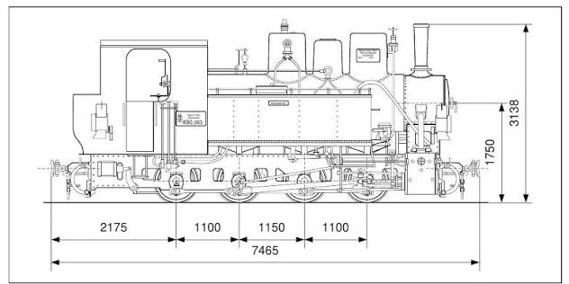

## Historical Overview

Marostordai HÉV (*Maros-Torda Helyi Érdekű Vasút*; English: Maros-Torda Local Interest Railway) was a 760 mm narrow-gauge network centred on Târgu Mureș (Marosvásárhely) in Transylvania, operated by MÁV and subsequently by CFR.

The twelve Budapest-built locomotives covered here are recorded with the Marostordai HÉV at Marosvásárhely in 1914. During the First World War, many were transferred or loaned to military and other narrow-gauge railways. Five—490.021, 490.023, 490.026, 490.027 and 490.028—are recorded as passing to CFR in November 1918; the others passed to SHS or remained with MÁV. Locomotive 490.023 subsequently returned to the Marostordai HÉV on 22 March 1941.

These locomotives belong to the wider type 70 family, of which 142 were built in Budapest between 1905 and 1950. MÁV initially classified its examples as XXIc, adopting the class 490 designation after 1911; not all type 70 locomotives belonged to MÁV.

## Technical Data

The following specifications describe early type 70 variants and are not necessarily exact specifications for every locomotive in this 1914 batch. Works numbers and original MÁV numbers refer specifically to the twelve locomotives covered here.

- **Wheel arrangement:** 0-8-0T, with Klien-Lindner hollow axles on the first and fourth coupled axles.
- **Gauge:** 760 mm.
- **Driving-wheel diameter:** 750 mm.
- **Rigid wheelbase:** 1,150 mm.
- **Minimum curve radius:** 30 m.
- **Boiler pressure:** 14 bar.
- **Grate area:** 1.04 m².
- **Heating surface:** 48.14 m².
- **Water capacity:** 2 m³.
- **Power:** approximately 120 hp / 88.3 kW for the original wood-fired version; 150 hp / 110 kW for the coal-fired version introduced in 1906.
- **Maximum speed:** 30 km/h for the early coal-fired version.
- **Builder:** MÁV Gépgyár (MÁV Machine Factory), Budapest; later MÁVAG.
- **Works numbers:** 3153–3164 of 1914.
- **MÁV class:** 490.
- **Original MÁV numbers:** 490.020–490.031.

*A MÁV type 70 / class 490 narrow-gauge locomotive. The drawing illustrates the general appearance of the type, rather than a specific 1914 locomotive.* [420]

Technical background: Malatinszky, pp. 25–26; locomotive identities and histories: Pospichal.

## Operational Timeline

Dates and allocations follow Pospichal’s revised Marostordai HÉV roster. The separate initial-allocation and MÁV-number entries reproduce the distinction in that roster without assuming that either date marks the start of regular service. An em dash means that no information is given, not that an event did not occur.

| Works number | MÁV number | Initial allocation recorded: Marostordai HÉV, Marosvásárhely (Romanian: Târgu Mureș) | Subsequent MÁV-number entry |
|:---|:---|:---|:---|
| 3153/1914 | 490.020 | 13 May 1914 | 16 September 1914 |
| 3154/1914 | 490.021 | 27 May 1914 | 16 September 1914 |
| 3155/1914 | 490.022 | 14 May 1914 | 16 September 1914 |
| 3156/1914 | 490.023 | 27 May 1914 | 16 September 1914 |
| 3157/1914 | 490.024 | 25 September 1914 | 6 November 1914 |
| 3158/1914 | 490.025 | 26 September 1914 | 6 November 1914 |
| 3159/1914 | 490.026 | 17 September 1914 | 6 November 1914 |
| 3160/1914 | 490.027 | 19 September 1914 | 6 November 1914 |
| 3161/1914 | 490.028 | 3 October 1914 | 19 December 1914 |
| 3162/1914 | 490.029 | 3 October 1914 | 19 December 1914 |
| 3163/1914 | 490.030 | 9 October 1914 | 27 October 1914 |
| 3164/1914 | 490.031 | 13 October 1914 | 19 December 1914 |

| MÁV number | First World War movements | Post-war allocation and renumbering | Later history | Withdrawal |
|:---|:---|:---|:---|:---|
| 490.020 | 11 October 1914: kukHV (Krivajatalbahn); 20 April 1915: MÁV Marostordai HÉV; November 1915: kukHV (Zabrežje–Valjevo); 27 September 1916: MÁV Nagyszeben–Segesvár; 29 November 1916: kukHV (Gyergyóvárhegy–Récefalva); 13 May 1918: Rózsahegy–Koritniczai HÉV; 21 September 1918: Steinbeisbahn; November 1918: kukHV (Bosanski Brod), chronology unresolved (see notes) | 4 December 1918: SHS 490.020; 1933: JDŽ 81-005 | 10 April 1941: HDŽ 81-005; 1945: JDŽ 81-005 | — |
| 490.021 | November 1915: kukHV (Zabrežje–Valjevo); 27 September 1916: MÁV Marostordai HÉV | November 1918: CFR 490.021 | — | 29 August 1969 |
| 490.022 | 11 October 1914: kukHV (Krivajatalbahn); 22 April 1915: MÁV Marostordai HÉV; November 1915: kukHV (Zabrežje–Valjevo); 16 September 1916: MÁV Marostordai HÉV; 21 October 1918: kukHV (Bosanski Brod) | 4 December 1918: SHS 490.022; 1933: JDŽ 81-006 | 10 April 1941: HDŽ 81-006; 1945: JDŽ 81-006; 1953: JŽ 81-006; subsequently Banovići (undated) | — |
| 490.023 | November 1915: kukHV (Zabrežje–Valjevo); 15 September 1916: MÁV Nagyszeben–Segesvár; 22 November 1916: Steinbeisbahn 44 (loan); 6 August 1917: kukHV Dombó–Nyéresháza (Teresva); 12 September 1917: kukHV (Gyergyóvárhegy–Récefalva); 8 October 1917: MÁV Torda–Abrudbánya | November 1918: CFR 490.023 | September 1940: MÁV Szatmár–Bicsád; 22 March 1941: MÁV Marostordai HÉV; 10 June 1943: Berehovo; November 1944: SZD Berehovo | 24 July 1957 |
| 490.024 | 11 November 1914: kukHV (Krivajatalbahn); 9 April 1915: MÁV Marostordai HÉV; 29 January 1916: kukHV (Klausen–Plan); 8 February 1918: MÁV Marostordai HÉV; 25 February 1918: Garešnica; October 1918: kukHV Heeresbahn Süd | 1918: SHS 490.024, Split; 1933: JDŽ 81-002 | 10 April 1941: HDŽ 81-002; 1945: JDŽ 81-002; 1953: JŽ 81-002 | — |
| 490.025 | 6 November 1914: kukHV (Krivajatalbahn); 12 April 1915: MÁV Marostordai HÉV; November 1915: kukHV (Zabrežje–Valjevo); 16 September 1916: MÁV Marostordai HÉV; 7 August 1917: kukHV Dombó–Nyéresháza (Teresva); 24 October 1917: Steinbeisbahn 50 (loan) | 3 November 1918: SHS 490.025 | 1930s (inferred): PDI Rudnik Ljubija | — |
| 490.026 | 6 November 1914: kukHV (Krivajatalbahn); 12 April 1915: MÁV Marostordai HÉV; November 1915: kukHV (Zabrežje–Valjevo); 6 September 1916: MÁV Nagyszeben–Segesvár | November 1918: CFR 490.026 | — | — |
| 490.027 | 6 November 1914: kukHV (Krivajatalbahn); 12 April 1915: MÁV Marostordai HÉV | November 1918: CFR 490.027 | September 1940: MÁV Szatmár–Bicsád; September 1944: CFR | 12 November 1970 |
| 490.028 | — | November 1918: CFR 490.028 | — | — |
| 490.029 | — | MÁV | 3 September 1939: Gánt no. 1; from 1945: Gánt no. 1 “József” | 20 February 1967 |
| 490.030 | 29 December 1915: kukHV (Zabrežje–Valjevo); 27 September 1916: MÁV Marostordai HÉV | MÁV; 14 November 1920: Lillafüred 3; 1929: LÁEV Miskolc 6 | 1942: Taracköz K46.911; November 1944: SZD 46.911; 1948: SZD Berehovo 7 | 1957 |
| 490.031 | 19 December 1914: kukHV (Krivajatalbahn); 9 April 1915: MÁV Marostordai HÉV; 1 February 1916: kukHV (Klausen–Plan); 15 April 1917: kukHV (Fleimstalbahn); 20 June 1917: kukHV (Klausen–Plan); 14 February 1918: Steinbeisbahn 51 (loan) | 3 November 1918: SHS 490.031; 1933: JDŽ (number not specified) | 1930s (inferred): PDI Rudnik Ljubija | 1940s (?) |

### Notes on the Source

- The roster distinguishes each locomotive’s first dated Marostordai HÉV entry from a subsequent entry carrying its MÁV number. Their precise administrative significance is not explained in the reproduced entries.
- For 490.020, Pospichal lists November 1918 at Bosanski Brod before a Steinbeisbahn entry dated 21 September 1918. Both dates are retained here, ordered by date; whether this represents a return movement or a dating inconsistency remains unresolved.
- Withdrawal does not necessarily establish the date of physical scrapping.
- The source records CFR allocations for five locomotives in November 1918, but those entries alone do not identify their subsequent depots or routes.

## Glossary

| Term | Description |
|:---|:---|
| MÁV | *Magyar Államvasutak* — Hungarian State Railways. |
| Marostordai HÉV | Maros-Torda Local Interest Railway, centred on Marosvásárhely (Târgu Mureș), Transylvania. |
| HÉV | *Helyi Érdekű Vasút* — local-interest railway. |
| SHS | Railway designation associated with the Kingdom of Serbs, Croats and Slovenes. |
| JDŽ | *Jugoslovenske državne železnice* — Yugoslav State Railways. |
| JŽ | *Jugoslovenske železnice* — Yugoslav Railways; the revised roster records this designation from 1953 for 81-002 and 81-006. |
| HDŽ | *Hrvatske državne železnice* — Croatian State Railways, the railway administration of the Independent State of Croatia during the Second World War. |
| CFR | *Căile Ferate Române* — Romanian State Railways. |
| SZD | Soviet Railways. |
| Bp | Budapest; used in the source for the Budapest locomotive works. |
| kukHV | Imperial and Royal Military Administration (*Heeresverwaltung*) of Austria-Hungary. |
| Krivajatalbahn | Krivaja Valley narrow-gauge railway in Bosnia. |
| Zabrežje–Valjevo | Narrow-gauge railway in Serbia. |
| Nagyszeben–Segesvár | Sibiu–Sighișoara railway, referred to by its Hungarian place-names. |
| Gyergyóvárhegy–Récefalva | Railway identified by these historical Hungarian place-names in the source; Gyergyóvárhegy is Subcetate, Romania. |
| Rózsahegy–Koritniczai HÉV | Ružomberok–Korytnica local railway, now in Slovakia. |
| Bosanski Brod | Railway centre on the Sava in Bosnia and Herzegovina, now named Brod. |
| Dombó–Nyéresháza / Teresva | Historical railway designation used in the source for the Tarac Valley area, now in Zakarpattia, Ukraine. |
| Torda–Abrudbánya | Turda–Abrud railway, Romania. |
| Szatmár–Bicsád | Historical designation used by the source for the Satu Mare–Bixad railway. |
| Klausen–Plan | Val Gardena railway, from Chiusa (Klausen) to Plan, now in northern Italy. |
| Fleimstalbahn | Val di Fiemme railway from Ora (Auer) to Predazzo, now in Italy; originally 760 mm gauge. |
| Steinbeisbahn | Narrow-gauge railway system in north-western Bosnia; “Leihlok” in the source identifies a loan locomotive. |
| Garešnica | Croatian locality recorded as a destination for 490.024 in February 1918. |
| Heeresbahn Süd | Military railway designation retained from the source for 490.024’s October 1918 allocation. |
| Split | Croatian coastal city, recorded as 490.024’s SHS allocation. |
| Banovići | Bosnian mining railway location recorded in the later history of 81-006. |
| PDI Rudnik Ljubija | Ljubija mine railway near Prijedor, Bosnia and Herzegovina; the expansion of “PDI” remains unconfirmed here. |
| Lillafüred / LÁEV Miskolc | Lillafüred State Forest Railway near Miskolc, Hungary; 490.030 became no. 3 in 1920 and no. 6 in 1929. |
| Gánt | Gánt bauxite-mine railway, Hungary. In the source, “Gánt 1” denotes locomotive no. 1 of that railway; “JÓZSEF” is the locomotive’s name, adopted from 1945. |
| Taracköz | Historical place-name retained from the source’s 1942 entry for 490.030. |
| Berehovo | Source spelling for Berehove, Zakarpattia, Ukraine, historically Beregszász in Hungarian. |

## Bibliography

- Josef Pospichal, [*Lokstatistik: Marostordai HÉV*](https://www.pospichal.net/lokstatistik/53812-marostordai%20hev.htm), revised roster supplied on 7 November 2026 — principal source for the individual locomotive histories.
- Bernhard Schmeiser and Franz Kraus, manuscript records, and Attila Kirchner’s database — underlying material credited in the earlier Pospichal roster; consulted indirectly through Pospichal, not independently.
- Sándor Malatinszky, [“The Class 490 Steam Engines of MÁV, and the Restoration of Locomotive No. 490,039”](https://doi.org/10.3311/pp.tr.2011-1.05), *Periodica Polytechnica Transportation Engineering* 39/1 (2011), pp. 23–30 — type history and technical background.
- Josef Pospichal, personal correspondence with the author, November 2026 — notification of the roster revision and the absence of further Ljubija sources.
