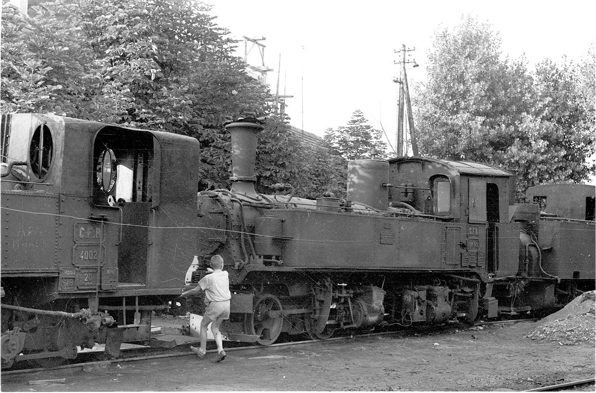

Saxon IV K No. 148 (Hartmann 3211/1908) CFR IVK-148 in 1967 at Târgu Mureş, shortly before being scrapped in 1968.
[source](https://www.drehscheibe-online.de/foren/read.php?017,9170168)

## Historical Overview

The **Sächsische IV K Nr. 148 (Hartmann 3211)** is a narrow-gauge Günther-Meyer type articulated steam locomotive built in 1908 for the Royal Saxon State Railways. Requisitioned for military field rail service during World War I, the engine was deployed to Transylvania and remained there after the 1918 border redraws as war reparations.

Absorbed into the Romanian State Railways (CFR), it uniquely retained its original designation as **IVK-148** and spent decades operating on the 760mm narrow-gauge network centred around Târgu Mureș. Unlike its sister locomotives back in East Germany, it was never modernised or reconstructed, running in its original mechanical form for nearly 60 years until it was retired and scrapped around 1968.

## Technical Data

### General

| EN (GB) | DE | Data |
| :--- | :--- | :--- |
| Works number (w/n) | Fabriknummer (FN) | 3211 |
| Year of manufacture | Baujahr | 1908 |
| Manufacturer | Hersteller | Sächsische Maschinenfabrik vorm. Rich. Hartmann, Chemnitz |
| Wheel arrangement (Whyte notation) | Achsformel (Whyte) | 0-4-0+0-4-0T |
| Wheel arrangement & drive (UIC notation) | Achsformel & Bauart (UIC) | B'B' n4v |
| Articulation type | Gattung / Bautyp | Günther-Meyer |
| Original track gauge | Ursprüngliche Spurweite | 750 mm (Saxon narrow gauge) |
| Original Railway Network | Erstbesteller | Königlich Sächsische Staatseisenbahnen (K.Sächs.St.E.) / Royal Saxon State Railways |
| Running Number when New | Erstnummerierung | 148 |
| Subsequent Identity (CFR) | Spätere Betriebsnummer (CFR) | IVK-148 |

## Operational Timeline

- **1908 (Delivery)**: Delivered from the Chemnitz works to the Royal Saxon State Railways as class IV K, running number 148.
- **World War I (Military Deployment)**: Requisitioned by the German Heeresfeldbahn and sent to Transylvania (Siebenbürgen), then part of Austria-Hungary, for military field railway duties.
- **Post-WWI Border Shifts**: With the collapse of Austria-Hungary and the Treaty of Trianon, Transylvania passed to Romania. The locomotive never returned to Saxony — it was left behind on what had become Romanian territory and was absorbed into the CFR fleet as war reparations. This is the same event recorded in Saxon rosters as No. 148 being "left behind in Hungary": at the time of its loss it stood in Transylvania, which was Hungarian soil until 1918 and Romanian thereafter.
- **CFR Service**: Assigned to the regional 760mm narrow-gauge network (the slightly wider track gauge accepted the 750mm Saxon wheelsets without mechanical re-gauging) centred on Târgu Mureș (Neumarkt am Mieresch). It was used for agricultural freight, light regional passenger traffic, and timber haulage from the surrounding Carpathian forests. The Günther-Meyer twin-bogie arrangement (Triebdrehgestelle) suited the tight, winding alignments of the rural network well.
- **Unusual Numbering**: Whereas most absorbed foreign locomotives were renumbered into standard CFR classifications, this engine kept its historic Saxon identity on the plates and ran as **IVK-148**.
- **World War II (1940–1944)**: Following the Second Vienna Award, Northern Transylvania — including Târgu Mureș — came under Hungarian administration, and the locomotive briefly fell under Hungarian railway operation before reverting to Romanian control after the war.
- **End of the Line**: Remained in service at the Târgu Mureș depot until 1967, outliving nearly all of its unreconstructed contemporaries, and was cut up for scrap around 1968.

## Note on the Number 148

The running number 148 was reused elsewhere in the Saxon IV K fleet after this locomotive left Germany, so an IV K carrying "148" plates in a German collection today is not the engine described above. The Transylvanian 148 (Hartmann 3211) was scrapped in Romania and no part of it survives.

