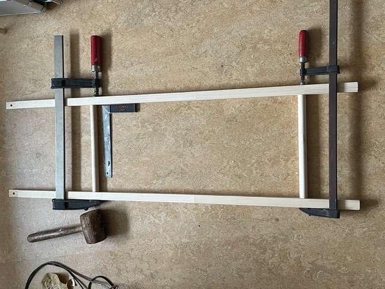
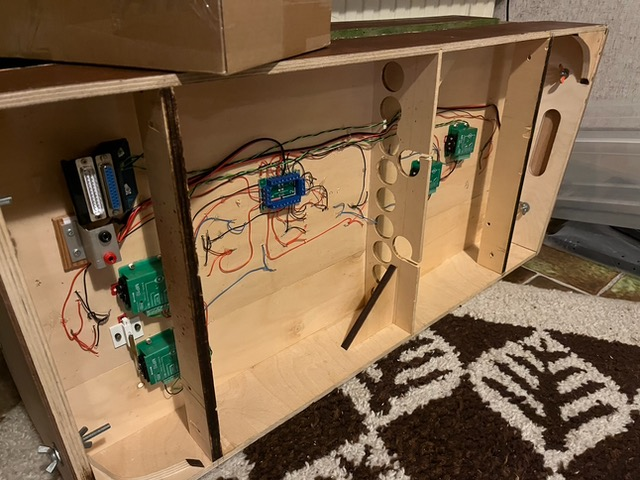
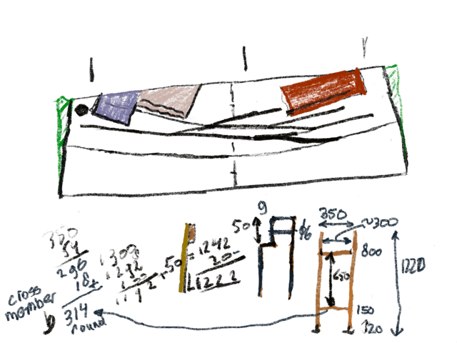

# FREMO Modules Legs - Notes from Henk

## Overview
October 2026 correspondence regarding his Fremo modules leg construction.

---

## Summary

| Component | Henk's Specification |
|-----------|----------------------|
| Legs | 27mm square |
| Cross Members | 22mm diameter |
| Depth Insert | 9mm into square vertical |
| Fasteners | M6 Wing bolts + wing nuts (or insets) |

---

## Construction Method

- Henk recommends that 6 mm marine plywood is sufficient for module tops and sides when adequately supported to prevent warping. He advises keeping modules as light as possible, noting that he has only used 9 mm plywood for boards 1.25 metres or longer with heavy track loads such as fiddle yards
- **2 cross members** for each pair of legs
- Legs screwed with **M6 wing bolts and wing nuts** (inset M6 alternative available but takes more time)
- **Forstner drill** needed for recessing round dowel into square vertical leg (9mm depth) — allows the 22mm round bar to protrude 9mm into the 27mm square leg
- Henk recommends using **8mm bolts** instead of 6mm spec to allow some play during module connection
- Landscape-dependent choice: Depending on the landscape: flat top or open to allow undulations and appropriate side boards.

---

## Visual References from Henk

*(Images referenced from your uploaded files)*

> *Fig 1: Cross members being assembled with clamps. Wooden dowel cross pieces, not metal bars.*

> *Fig 2: Interior/underside view of completed **closed-top** module showing wiring, electronics, and internal bracing compartments.*

> *Fig 3: Hand-drawn technical sketch showing module dimensions (800mm, 1220mm heights noted) and leg configuration with cross member details.*

---

