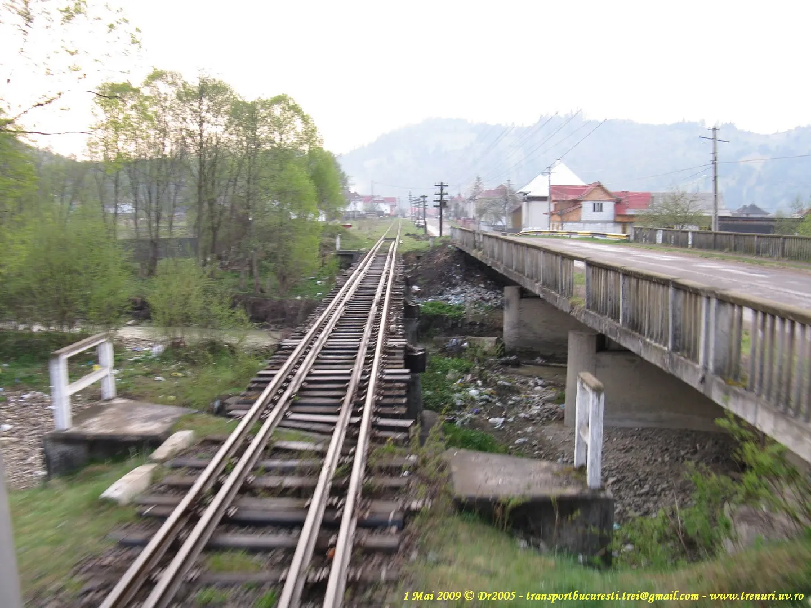

# The Railway Bridge over "Dragosa" River

## Location & Structure

- **Site:** Near "Dragosa" halt towards Moldovita, Romania
- **Crossing:** Dragosa River
- **Layout:** Railway bridge + road bridge running parallel

(c) Dr2005, 1 May 2009

## Railway Bridge Details

| Component | Count | Description |
|-----------|-------|-------------|
| Abutments | 2 | One on each side of watercourse |
| Concrete pillars | 3 | Intermediate supports (hardly visible in photo) |
| Structural bays | 4 | Spaces between the 5 support points |

## Dimensions for Modeling

| Measurement | Real World | N-Gauge (1:160) | Basis |
|-------------|------------|-----------------|-------|
| Standard gauge | 1435 mm | **~9 mm** | Actual N-gauge rail specification |
| Rail-to-rail outer width | ~1.5 m | **~9–10 mm** | Gauge + rail head width |
| Bridge bay spacing | ~3–3.5 m | **~19–22 mm** | Estimated from pillar count |
| Total bridge length | 12–16 m | **75–100 mm** (recommended: **87–88 mm**) | ~8–10× gauge width from photo |

## Additional Context

- **Era:** Mid-20th century rural Romanian railway infrastructure
- **Span type:** Standardized multi-bay construction
- **Road bridge:** Parallel crossing, 2 concrete pillars visible

## Planning Notes

- Scale tolerance: ±2–3 m uncertainty from visual estimation (±13–19 mm at 1:160)
- For precision: consult CFR architectural drawings or site measurements
- Estimation method: gauged bridge length against rail-to-rail width in the annotated photo
- At 1:160, your finished bridge should measure roughly 8–9 cm overall

