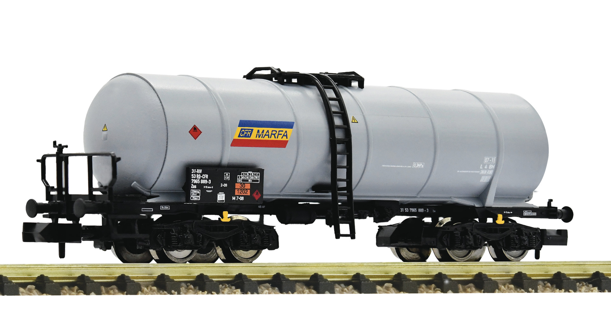
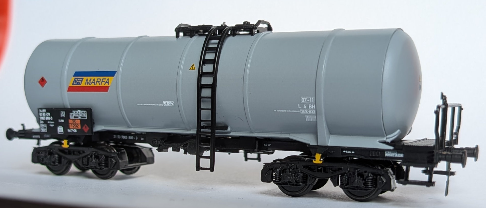
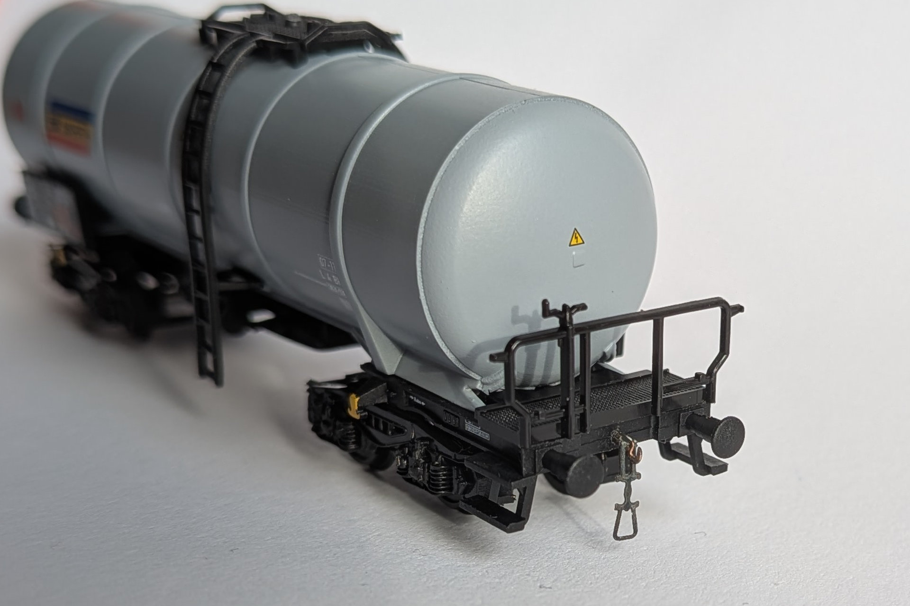
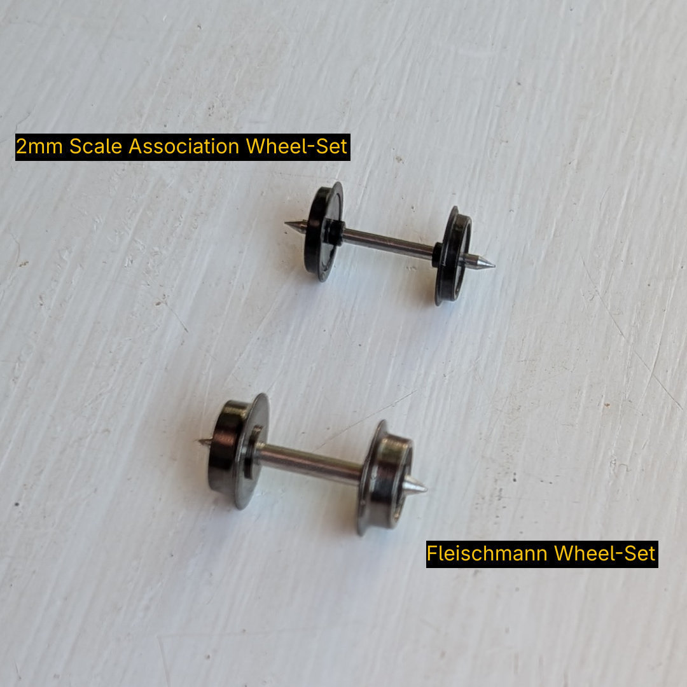

This Fleischmann N scale model of a grey Zas type four-axle tank wagon represents a "CFR Marfă" vehicle from Epoch VI. It runs on the Dragosa layout with new fine-scale wheelsets and magnetic couplings.

*Fleischmann N scale catalogue illustration*

## Model

| Item | Detail |
|---|---|
| Manufacturer | Fleischmann |
| Scale | N |
| Catalogue number | 881224 |
| EAN | 4005575257251 |
| Length over buffers | 88 mm |

A [short review](cm-2022-01-review.pdf) of this model, in a different livery, appeared in the January 2022 issue of Continental Modeller.

## Prototype

| Item | Detail |
|---|---|
| Type | Zas tank wagon, four axles |
| Epoch | VI |
| Railway company | CFR Marfă |
| Operating number | 31 53 7965 889-3 RO-CFR |

The prototype is a four-axle tank wagon of the type Uahs, known as the Zas from 1980. It was built from 1972 and, according to Fleischmann, has a load capacity of 880 hl (88 m³). Wagon-hire companies offered these wagons to many railway administrations as private wagons. They carried light petroleum products, mainly in block trains from sea ports to inland locations, and also in wagon-load traffic to the unloading facilities of mineral-oil traders.

This example carries CFR Marfă livery. CFR Marfă is Romania’s state-owned freight railway operator; it was formerly the freight division of Căile Ferate Române (CFR) and was separated in 1998 to become a semi-independent business. [Wikipedia](https://en.wikipedia.org/wiki/CFR_Marf%C4%83)

Further details on the type are available from [VTG](https://www.vtg.com/solutions/fleet/mineraloel-kesselwagen-hell/mineral-oil-rail-tank-car_zas_m16086c).

## "fiNe-scale" Conversion

The wagon has been converted to fine-scale standards in two areas:

* The original wheels were replaced with re-gauged 2 mm Fine Scale Association wagon wheels, which have plain discs, a diameter of 6 mm and a 15.20 mm axle (part number 2-0089).

* The couplings were replaced with SMK (Schiffer-Magnetfeld-Kupplung) magnetic couplings for N gauge.

*General view of the converted model*

*SMK magnetic coupling fitted to the buffer beam*

## Build notes

The original four wheelsets were removed and replaced with fine-scale wagon wheelsets. The wheelsets were re-gauged from the ["2 mm Scale Association" standard](https://2mm.org.uk/2FS_Manual/Standards_Combined.pdf#page=2) (minimum back-to-back of 8.51 mm) to the [fiNe-scale standard](https://www.fs160.eu/fiNeweb/standards/HANDB.php) of 8.2 mm, with a minimum of 8.1 mm. A digital caliper was used to set the back-to-back distance.

The original Fleischmann KK (Kurzkupplung, close coupling) couplers fitted on the original model were removed and replaced with SMK magnetic couplings. Each SMK hook was installed in a 0.8 mm hole drilled in the centre of the buffer beam and secured in place with CA glue.

*Comparison between wheels-sets*

